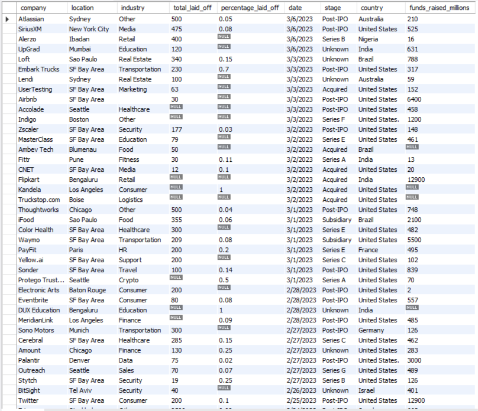
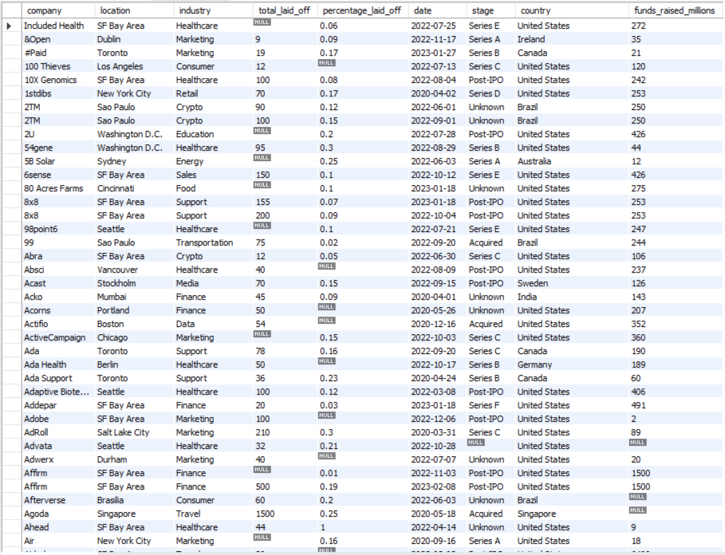

# World Layoffs: Data Cleaning & Exploratory Analysis (SQL)

Cleaning a raw layoffs dataset with MySQL, then exploring it to see which companies, industries, countries, and time periods were hit hardest between March 2020 and March 2023.

## Project Overview

| | |
|---|---|
| **Tool** | MySQL Workbench (MySQL 8) |
| **Dataset** | Layoffs dataset from Alex the Analyst's Data Analyst Bootcamp |
| **Period covered** | 2020-03-11 to 2023-03-06 |
| **Raw rows** | 2,361 |
| **Clean rows** | 1,995 |
| **SQL skills used** | Staging tables, CTEs, window functions (`ROW_NUMBER`, `DENSE_RANK`, rolling `SUM`), self joins, string and date functions, aggregation |

## Business Questions

1. How large were the biggest layoffs?
2. Which companies, industries, countries, and funding stages had the most layoffs?
3. How did layoffs change over time?
4. Which companies had the most layoffs in each year?

## Part 1: Data Cleaning

Script: [`layoffs_data_cleaning.sql`](layoffs_data_cleaning.sql)

| Before | After |
|---|---|
|  |  |

Steps:

1. **Staging tables.** Worked on copies so the raw table stays untouched.
2. **Removed duplicates.** Used `ROW_NUMBER()` partitioned by every column and deleted rows numbered 2 or higher. This removed 5 duplicate rows.
3. **Standardized the data.**
   - Trimmed extra spaces in `company`.
   - Merged "Crypto Currency" into "Crypto" in `industry`.
   - Removed the trailing period in "United States." in `country`.
   - Converted `date` from text to a real `DATE` type.
4. **Handled blanks and NULLs.** Converted blank industries to NULL, then filled them from other rows of the same company using a self join. One company (Bally's Interactive) appears only once, so its industry could not be filled and stays NULL.
5. **Removed unusable rows and columns.** Deleted 361 rows that had neither `total_laid_off` nor `percentage_laid_off`, and dropped the helper `row_num` column.

**Result:** 2,361 raw rows became 1,995 clean rows (5 duplicates and 361 rows with no layoff data were removed).

## Part 2: Exploratory Data Analysis

Script: [`layoffs_exploratory_analysis.sql`](layoffs_exploratory_analysis.sql)

### Key Findings

- **Scale:** the largest single layoff was 12,000 employees, and some companies laid off 100% of their staff.
- **Top companies overall:** Amazon (18,150), Google (12,000), and Meta (11,000).
- **Country:** the United States had 256,559 layoffs, about 67% of the total. India was second (35,993), then the Netherlands (17,220).
- **Industry:** Consumer (45,182), Retail (43,613), and Transportation (33,748) led the named industries.
- **Funding stage:** Post-IPO companies accounted for 204,132 layoffs, about 53% of the total.
- **By year:** 2022 had the highest total (160,661) and 2021 the lowest (15,823).
- **2023 pace:** the data ends on 2023-03-06, so 2023 covers only about two months, yet it already reached 125,677 layoffs. January 2023 (84,714) was the largest month in the dataset.
- **Early 2020 spike:** March to May 2020 had 62,142 layoffs, about 77% of that year's total, then the numbers dropped sharply.
- **Top company each year:** Uber (2020), Bytedance (2021), Meta (2022), Google (2023).

### Data Limitations

- 500 layoffs have no date, so they are missing from the monthly and yearly trends.
- One company (Bally's Interactive) still has a NULL industry because it has only one row to learn it from.
- 2023 is a partial year, so it can't be compared directly with full years.
- "Other" (industry) and "Unknown" (stage) are catch-all categories, not real groups.
- `percentage_laid_off` is stored as text, so percentage calculations depend on MySQL converting it automatically.

## How to Run

1. Import `raw_layoffs.csv` into a MySQL schema named `world_layoffs` as a table named `layoffs`.
2. Run `layoffs_data_cleaning.sql`.
3. Run `layoffs_exploratory_analysis.sql`.

## Files

```
01-sql-layoffs-cleaning/
├── README.md
├── layoffs_data_cleaning.sql
├── layoffs_exploratory_analysis.sql
├── raw_layoffs.csv
└── screenshots/
    ├── raw_data.png
    └── cleaned_data.png
```

## What I Learned

- Keeping the raw data untouched by working on staging tables.
- Finding duplicates with window functions when a table has no unique ID.
- Reading results carefully: checking what a column is sorted by, and what time period a total covers.

## Next Steps

- Change `percentage_laid_off` to a numeric type.
- Build a Tableau or Power BI dashboard from the cleaned table.
