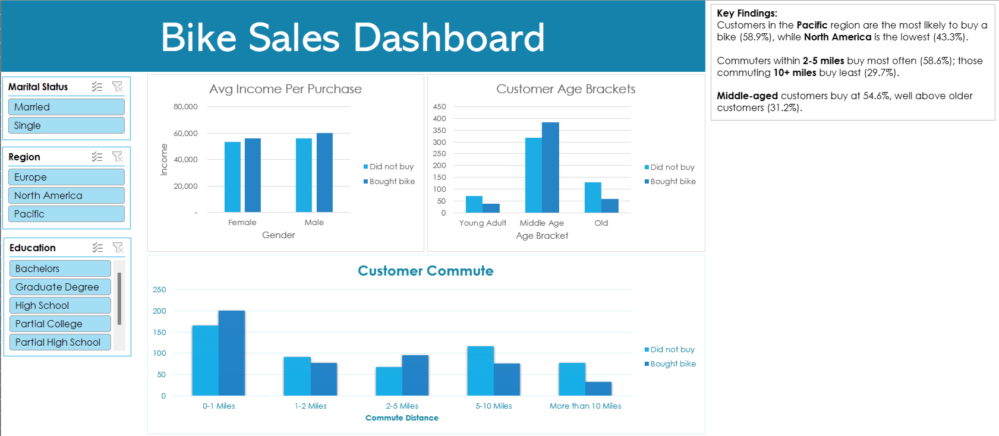

# Bike Sales Dashboard (Excel)

An interactive Excel dashboard that explores which customer traits are linked to buying a bike, built from 1,000 customer records with pivot tables, pivot charts, and slicers.



## Project Overview

| | |
|---|---|
| **Tool** | Microsoft Excel |
| **Dataset** | Bike buyers dataset from Alex the Analyst's Data Analyst Bootcamp |
| **Records** | 1,000 customers |
| **Excel skills used** | Data cleaning, pivot tables, pivot charts, slicers, "% of Row Total" calculations |
| **File** | [Bike Sales Dashboard.xlsx](Bike%20Sales%20Dashboard.xlsx) |

## Business Question

Which customer characteristics (region, commute distance, age, income) are most linked to buying a bike?

## What I Did

1. **Cleaned the data.**
   - Replaced abbreviations: M/S became Married/Single, and M/F became Male/Female.
   - Wrote out the full Commute Distance and Education labels.
   - Added an **Age Bracket** column: Young Adult (30 and under), Middle Age (31 to 54), and Old (55 and over).
2. **Built pivot tables** for average income, commute distance, and age bracket, each split by whether the customer bought a bike.
3. **Built the dashboard.** Three pivot charts plus three slicers (Marital Status, Region, Education) that filter every chart at once.
4. **Calculated purchase rates** using "Show Values As > % of Row Total", so the groups can be compared fairly even when they have different sizes.

## Key Findings

Overall, **48.1%** of customers (481 of 1,000) bought a bike.

- **Region:** Pacific customers buy the most (58.9%), followed by Europe (49.3%) and North America (43.3%).
- **Commute distance:** customers with a 2 to 5 mile commute are the most likely to buy (58.6%), and those with a 10+ mile commute are the least likely (29.7%).
- **Age:** middle-aged customers buy at 54.6%, compared with 35.5% for young adults and 31.2% for older customers. Middle-aged customers are also the largest group (701 of 1,000).
- **Income:** buyers earn more on average than non-buyers ($57,963 vs $54,875, about $3,100 more).

## Limitations

- These are patterns in one dataset of 1,000 customers. They show a link between traits and buying, not what causes it.
- The age brackets are my own cut-off points, so changing them could change the results.

## How to Use the Dashboard

1. Open `Bike Sales Dashboard.xlsx` and go to the **Dashboard** tab.
2. Click a button in a slicer (for example, "Married") to filter all three charts.
3. Click the filter icon with the X at the top right of a slicer to reset it.

## Files

```
02-excel-bike-sales/
├── README.md
├── Bike Sales Dashboard.xlsx
└── dashboard.png
```

## What I Learned

- Using percentages instead of raw counts to compare groups of different sizes.
- Starting chart axes at zero so differences are not exaggerated.
- Turning a dashboard into a short list of findings that a reader can act on.
