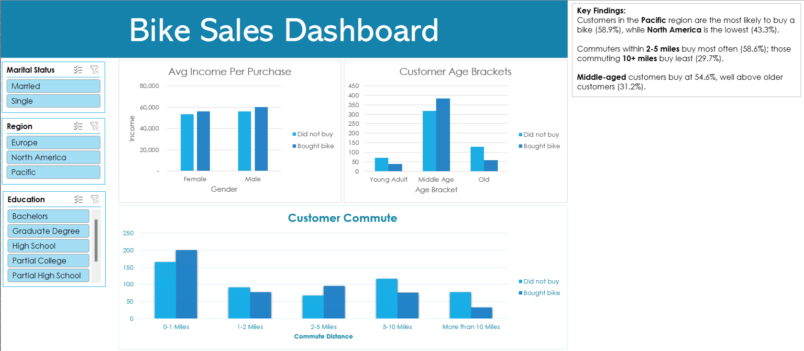

# Data Analytics Portfolio

Hi, I'm **Kelvin Barcelona (Kelvs)**, a Computer Science graduate (June 2026) building a career as a data analyst. This repository holds my projects, with the code, the data, and the findings for each one.

## Skills

| Area | Tools |
|---|---|
| **Databases and SQL** | MySQL: CTEs, window functions, joins, subqueries, data cleaning |
| **Spreadsheets** | Excel: pivot tables, pivot charts, slicers, dashboards |
| **Visualization** | Tableau, Power BI |
| **Programming** | Python (currently learning: pandas for cleaning and exploration) |

## Projects

### 1. World Layoffs: Data Cleaning & Exploratory Analysis (SQL)

Cleaned a raw layoffs dataset and explored which companies, industries, countries, and time periods were hit hardest between 2020 and 2023.

- Cleaned 2,361 raw rows into 1,995: removed duplicates, standardized text and dates, and filled missing values with a self join.
- Found that 2022 had the highest yearly total (160,661 layoffs), while 2023 reached 125,677 in only about two months.
- Skills: staging tables, CTEs, window functions (`ROW_NUMBER`, `DENSE_RANK`, rolling `SUM`), aggregation.

**[View the project](01-sql-layoffs-cleaning)**

### 2. Bike Sales Dashboard (Excel)

An interactive dashboard that explores which customer traits are linked to buying a bike, built from 1,000 customer records.

- 48.1% of customers bought a bike overall. Pacific customers buy the most (58.9%) and North America the least (43.3%).
- Customers with a 2 to 5 mile commute are the most likely to buy (58.6%), and those with a 10+ mile commute the least likely (29.7%).
- Skills: data cleaning, pivot tables, pivot charts, slicers, "% of Row Total" calculations.

**[View the project](02-excel-bike-sales)**

## Coming Soon

- **Seattle Airbnb dashboard** (Tableau)
- **Data professional survey dashboard** (Power BI)
- **Python data cleaning and exploration project** (pandas)

## Contact

- Email: [kelvsbarcelona16it@gmail.com](mailto:kelvsbarcelona16it@gmail.com)
- LinkedIn: [Kelvin Barcelona](https://www.linkedin.com/in/kelvin-barcelona-658a8b2b5)
- GitHub: [KelvinBarcelona](https://github.com/KelvinBarcelona)
